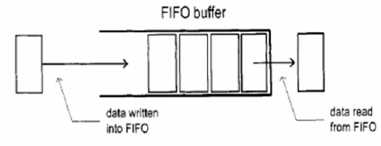
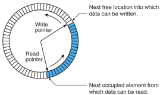
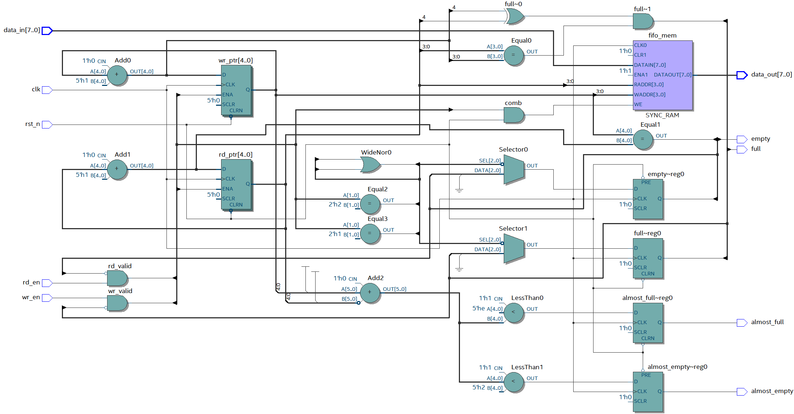
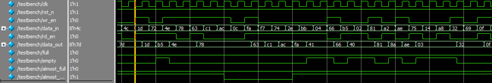

# Synchronous FIFO <!-- omit in toc -->

A parameterizable synchronous FIFO (First-In First Out) buffer implemented in Verilog with verification using SystemVerilog Testbench.

Clone the Repo:
```
git clone https://github.com/pletnevAE/FIFO_sync.git
```

## Contents <!-- omit in toc -->

- [Overview](#overview)
- [Theoretical basis](#theoretical-basis)
  - [FIFO](#fifo)
  - [Synchronous and asynchronous FIFO](#synchronous-and-asynchronous-fifo)
  - [Circular buffer](#circular-buffer)
  - [Full/empty ambiguity](#fullempty-ambiguity)
  - [Status flags](#status-flags)
  - [Standard read and First-Word Fall-Through](#standard-read-and-first-word-fall-through)
  - [Simultaneous read and write](#simultaneous-read-and-write)
  - [Memory implementation](#memory-implementation)
  - [FIFO depth and flag threshold](#fifo-depth-and-flag-threshold)
- [Architecture](#architecture)
- [Interface](#interface)
  - [Parameters](#parameters)
  - [Signals](#signals)
- [Utilization](#utilization)
- [Simulation](#simulation)
- [Building the project out-of-the-box](#building-the-project-out-of-the-box)

## Overview

The module implements a synchronous FIFO buffer: both the write port and the read port work from a signal clock. It is designed for temporary storage and rate matching of data streams between modules of FPGA-based digital systems.

Typical applications:

- buffering of data between modules that produce and consume data at different or irregular rates;
- conversion of bursty data into a continuous stream and vice versa;
- decoupling of pipeline stages and implementation of back-pressure in streaming interfaces;
- buffering of data of serial interfaces (UART, SPI and others);
- queues of commands, messages and packets.

## Theoretical basis

### FIFO

A FIFO is a data buffer in which words are read in the same order in which they were written: the word written first is read first.

<p align="center">
  
</p>

A FIFO has two independent sides:

- the **write side** (producer), which puts words into the buffer;
- the **read side** (consumer), which takes words out of the buffer;

Unlike an ordinary memory, a FIFO has no address inputs: the order of access is fixed by the FIFO itself.

Modules of a digital system rarely produce and consume data at exactly the same moments. For example, a source delivers a burst of 64 words one word per clock cycle, while the consumer is able to process only one word every 4 clock cycles. Or a source occasionally pauses and then continues. Without a buffer, either the producer has to wait for the consumer after every word, or data is lost.

A FIFO absorbs a temporary mismatch between the rates: the producer writes whenever it has data, the consumer reads whenever it is ready, and the FIFO fill level (the number of stored words, or *occupancy*) reflects the current difference between them.

Note that a FIFO only compensates a *temporary* mismatch. If the average write rate is permanently higher than the average read rate, a buffer of any finite size will sooner or later overflow.

### Synchronous and asynchronous FIFO

- **Synchronous FIFO** - the write and the read are performed on the same clock. It is used to buffer data inside one clock domain.
- **Asynchronous FIFO** - the write and the read have different, unrelated clocks. It is used for clock domain crossing and requires additional mechanisms (Gray-coded pointers and synchronizers), because the write pointer must be safely observed in the read clock domain and vice versa.

In a synchronous FIFO both pointers are available in one clock domain, so the fill level and the status flags can be determined exactly and without extra latency.

### Circular buffer

Inside the FIFO the words are stored in a memory array of $D = 2^{\mathrm{ADDR\\_WIDTH}}$ cells (the FIFO depth). The access order is controlled by two pointers:

- **write pointer** `wr_ptr` - the address of the cell where the next written word will be placed;
- **read pointer** `rd_ptr` - the address of the cell holding the oldest unread word.

On a write, the word is stored in the cell addressed by `wr_ptr`, and `wr_ptr` is incremented. On a read, the word is taken from the cell addressed by `rd_ptr`, adn `rd_ptr` is incremented. After the last cell the pointers wrap around to the cell 0, so the memory behaves like a ring (circular buffer). The words are never moved inside the memory: only the pointers move, which makes both operations take one clock cycle regardless of the FIFO depth.

<p align="center">
  
</p>

### Full/empty ambiguity

Consider the moment when both pointers point to the same cell. It can mean two opposite situations:

- the FIFO is **empty**: the reader has caught up with the writer;
- the FIFO is **full**: the writer has made a full lap and caught up with the reader.

Common ways to resolve this ambiguity:

1. keep a separate counter of stored words;
2. never fill the last cell (the FIFO is considered full when one free cell is left), which loses one cell of the capacity;
3. extend each pointer by one extra MSB.

This project uses the third option. The pointers are `ADDR_WIDTH + 1` bits wide:

- the lower `ADDR_WIDTH` bits are the memory address;
- the MSB is a "lap" bit: it toggles every time the pointer wraps around the end of memory.

Then:

- the FIFO is **empty** if the pointers are completely equal (the same cell, the same lap);
- the FIFO is **full** if the lower `ADDR_WIDTH` bits are equal, but the MSB differ (the same cell, but the writer is exactly one lap ahead).

The number of stored words is the difference of the pointers modulo $2^{\mathrm{ADDR\\_WIDTH} + 1}$

```math
N = (\mathrm{wr\_ptr} - \mathrm{rd\_ptr}) \bmod 2^{\mathrm{ADDR\\_WIDTH} + 1}, \qquad 0 \le N \le D
```

The extra bit is also needed to represent the value $N = D$ itself. All $D$ cells of the memory are usable.

Example for `ADDR_WIDTH = 2` (depth $D = 4$, 3-bit pointers):

| Step | Operation | `wr_ptr` | `rd_ptr` | Words stored | State |
| :--: | :--: | :--: | :--: | :--: | :--: |
| 1 | Reset | `000` | `000` | 0 | empty (pointers are equal) |
| 2 | 3 writes | `011` | `000` | 3 | - |
| 3 | 1 write | `100` | `000` | 4 | full (lower bits `00` = `00`, MSB `1` != `0`) |
| 4 | 1 read | `100` | `001` | 3 | - |
| 5 | 1 write | `101` | `001` | 4 | full (lower bits `01` = `01`, MSB `1` != `0`) |
| 6 | 4 reads | `101` | `101` | 0 | empty (pointer are equal) |

### Status flags

- `full` - the FIFO has no free cells. A write is not possible.
- `empty` - the FIFO has no stored words. A read is not possible.
- `almost_full` - the number of stored words has reached a programmable threshold (`ALMOST_FILL_VAL`). It is an early warning; only a few free cells are left.
- `almost_empty` - the number of stored words has dropped to a programmable threshold (`ALMOST_EMPTY_VAL`) or lower. It is an early warning: only a few words are left.

A write to a full FIFO would overwrite the oldest unread word (*overflow*), and a read from an empty FIFO would return meaningless data (*underflow*). Therefore, a correct FIFO ignores such operations, and the user is expected to monitor the flags.

The `almost_full` and `almost_empty` flags are useful because real producers and consumers react to a flag with delay (for example, the producer has its own pipeline). The `almost_full` flag lets the producer stop *before* the FIFO becomes completely full, and the `almost_empty` flag lets the consumer pause (or the producer speed up) *before* the FIFO becomes completely empty.

### Standard read and First-Word Fall-Through

There are two conventions for reading from a FIFO:

- **Standard read**: the consumer asserts the read request, and the requested word appears on the data output one clock cycle later.
- **First-Word Fall-Through (FWFT, show-ahead)**: the oldest word is already present on the data output whenever the FIFO is not empty.

In the FWFT mode the consumer can look at the word before consuming it. This maps naturally onto streaming handshakes: `!empty` plays the role of "data is valid", and `rd_en` plays the role of "data is accepted".

### Simultaneous read and write

In a synchronous FIFO a read and a write may be requested in the same clock cycle. Both pointers advance, the number of stored words stays unchanged, and the flags do not change. Two boundary cases require attention:

- the FIFO is **empty**: only the write is performed (there is nothing to read yet); the new word can be read in the following clock cycle;
- the FIFO is **full**: only the read is performed (the write is rejected because the is no free cell at the moment of the request).

### Memory implementation

The memory array of a FIFO can be implemented in two ways:

- **in logic (flip-flops / distributed registers)** - flexible, any word can be read combinationally at any moment, but it consumes many logic resources as the depth grows; it is suitable for small FIFOs;
- **in block RAM** (for example, M9K blocks of Intel MAX10) - efficient for large depths and wide words, but block RAM has a synchronous read (the read address is registered inside the block), which has to be taken into account in the read logic.

### FIFO depth and flag threshold

The minimum depth is determined by the worst-case burst. If a burst of $B$ words is written at one word per clock cycle, and during the burst the consumer reads at the rate of $r$ words per clock cycle ($r < 1$), then the FIFO has to be able to store at least

$$D_{min} \approx B \cdot (1 - r)$$

words. For example, for $B = 64$ and $r = 1/4$: $D_{min} \approx 48$, therefore the next power of two should be chosen, $D = 64$. In practice, a margin is added.

The thresholds of the `almost_full` and `almost_empty` flags depend on how quickly the neighbouring modules react. For `almost_full`, at least as many free cells should be reserved as the number of words that can still arrive between the moment the occupancy crosses the threshold and the moment the producer actually stops writing. This include the latency of the flag itself and the reaction time of the producer.

## Architecture

The FIFO is implemented as a single module **FIFO.v**:

<p align="center">
  
</p>

1. **Memory**: the array `fifo_mem` of $2^{\mathrm{ADDR\\_WIDTH}}$ words of `DATA_WIDTH` bits. The memory type is set by the synthesis attribute `ramstyle` taken from the `MEM_STYLE` parameter. The write is synchronous: thw word `data_in` is stored into the cell addressed by the lower `ADDR_WIDTH` bits of `wr_ptr`.
2. **Pointers**: the write pointer `wr_ptr` and the read pointer `rd_ptr` are `ADDR_WIDTH + 1` bits wide. They are updated on the clock edge when the corresponding operation is allowed. The next values `wr_ptr_next` and `rd_ptr_next` are used to calculate the flags.
3. **Operation qualification**: the requests are accepted only when they are possible:
    - a write operation occurs when the FIFO is not full and the write enable signal is asserted;
    - a read operation occurs when the FIFO is not empty and the read enable signal is asserted;

    Thus a write to a full FIFO and a read from an empty FIFO are ignored and cannot corrupt the stored data or the pointers.
4. **Occupancy**: the number of stored words `num elements = wr_ptr - rd_ptr` is calculated combinationally and is used for the `almost_full` and `almost_empty` flags.
5. **Flags logic**: all four flags are registered. `full` and `empty` are updated together with the pointers on the basis of the operation performed in the current clock cycle:

    | `wr_valid` | `rd_valid` | `empty` | `full` |
    | :--: | :--: | :--: | :--: |
    | `1` | `0` | `0` | `1` if `wr_ptr_next` and `rd_ptr` have equal lower bits and different MSBs |
    | `0` | `1` | `1` if `rd_ptr_next == wr_ptr` | `0` |
    | `0` or `1` | `0` or `1` | unchanged | unchanged |

    The flags `almost_full` and `almost_empty` are calculated from the current occupancy `num_elements`:
    - the `almost_full` flag is asserted when the FIFO occupancy is greater than or equal to a `ALMOST_FULL_VAL`;
    - the `almost_empty` flag is asserted when the FIFO occupancy is less than or equal to a `ALMOST_EMPTY_VAL`.

6. **Read output**: the oldest word is always present on the output (FWFT); it is valid while `empty = 0`.

Key implementation features:

- asynchronous Active-Low reset (`rst_n`);
- parameterization of data width, depth, flag thresholds and memory type;
- full capacity; all $2^{\mathrm{ADDR\\_WIDTH}}$ cells are usable;
- full/empty detection using pointers with an extra bit, without a separate counter;
- First-Word Fall-Through read;
- protection against overflow and underflow;
- simultaneous read and write in one clock cycle;
- registered flags (good for the timing of the control logic using them);
- memory type is selectable by synthesis attribute `ramstyle`.

## Interface

### Parameters

| Parameter | Default Value | Description |
| :--: | :--: | :--: |
| `DATA_WIDTH` | 8 | Input and output data width |
| `ADDR_WIDTH` | 4 | FIFO address width |
| `ALMOST_FULL_VAL` | $2^{\mathrm{ADDR\\_WIDTH}} - 2$ | Number of stored words at which `almost_full` is asserted (occupancy $\ge$ value) |
| `ALMOST_EMPTY_VAL` | 2 | Number of stored words at which `almost_empty` is asserted (occupancy $\le$ value) |
| `MEM_STYLE` | "M9K" | Memory type: `"logic"` - flip-flops, `"M9K"` - block RAM of MAX10 |

### Signals

| Port | Direction | Width | Description |
| :--: | :--: | :--: | :--: |
| `clk` | Input | 1 | Clock Signal |
| `rst_n` | Input | 1 | Asynchronous Active-Low Reset |
| `wr_en` | Input | 1 | Write enable signal |
| `data_in` | Input | `DATA_WIDTH` | Input data |
| `rd_en` | Input | 1 | Read enable signal |
| `data_out` | Output | `DATA_WIDTH` | Output data |
| `full` | Output | 1 | FIFO full flag |
| `empty` | Output | 1 | FIFO empty flag |
| `almost_full` | Output | 1 | FIFO almost full flag |
| `almost_empty` | Output | 1 | FIFO almost empty flag |

## Utilization

The project was synthesized for the 10M50DAF484C6GES FPGA on the DE10-Lite board using Quartus 22.1 Standard Edition. Timing constraints are specified in **FIFO.sdc**: the clock `clk` with the period of 20 ns (50 MHz), automatically derived clock uncertainty, and the false path from the `rst_n` port.

| FPGA | `DATA_WIDTH` | `ADDR_WIDTH` | `ALMOST_FULL_VAL` | `ALMOST_EMPTY_VAL` | `MEM_STYLE` | LUT | FF | Memory bits | $F_{max}$, MHz | Hold Slack, ns | Setup Slack, ns |
| :--: | :--: | :--: | :--: | :--: | :--: | :--: | :--: | :--: | :--: | :--: | :--: |
| 10M50DAF484C6GES | 8 | 4 | 14 | 2 | "M9K" | 62 | 40 | 128 | 290.87 | 0.331 | 16.562 |
| 10M50DAF484C6GES | 8 | 4 | 14 | 2 | "logic" | 205 | 142 | 0 | 239.46 | 0.331 | 15.824 |
| 10M50DAF484C6GES | 16 | 4 | 14 | 2 | "M9K" | 77 | 56 | 256 | 247.34 | 0.230 | 15.957 |
| 10M50DAF484C6GES | 16 | 4 | 14 | 2 | "logic" | 345 | 270 | 0 | 205.55 | 0.330 | 15.135 |
| 10M50DAF484C6GES | 16 | 8 | 254 | 2 | "M9K" | 104 | 72 | 4096 | 227.95 | 0.226 | 15.613 |
| 10M50DAF484C6GES | 16 | 8 | 254 | 2 | "logic" | 5106 | 4118 | 0 | 107.38 | 0.325 | 10.687 |

## Simulation

Simulation is performed in ModelSim 10.6d using the SystemVerilog testbench (**testbench.sv**). The testbench uses a reference model (scoreboard) of the FIFO - a SystemVerilog queue. In every clock cycle the outputs of the module are compared with the reference model. The stimulus is driven on the falling clock edge (the DUT samples stable values on the rising edge), and consecutive operations are issued in consecutive clock cycles without idle cycles in between (back-to-back), so the FIFO is tested at its maximum throughput.

| Parameter | Default value | Description |
| :--: | :--: | :--: |
| `CLK_PERIOD` | 20 | Clock period in ns |
| `RESET_CYCLES` | 10 | Number of clock cycles before reset release |
| `RAND_CYCLES` | 1000 | Number of iterations of the random test |
| `DATA_WIDTH` | 8 | Input and output data width |
| `ADDR_WIDTH` | 4 | Address width |
| `ALMOST_FULL_VAL` | $2^{\mathrm{ADDR\\_WIDTH}} - 2$ | Almost full threshold |
| `ALMOST_EMPTY_VAL` | 2 | Almost empty threshold |
| `MEM_STYLE` | `"M9K"` | Memory type |

The testbench consists of five tests:

1. back-to-back writes until the number of stored words reaches `ALMOST_FULL_VAL`;
2. back-to-back writes until the FIFO is full;
3. back-to-back reads until `ALMOST_EMPTY_VAL` words are left;
4. back-to-back reads until the FIFO is empty;
5. `RAND_CYCLES` clock cycles with random `wr_en`, `rd_en` and `data_in` in every clock cycle, including simultaneous read adn write. Reaching the boundary states during this test additionally checks that a write to a full FIFO and a read from an empty FIFO are ignored.

In every clock cycle the testbench checks:

1. `full` and `empty` flags against the number of words in the reference model after the clock edge;
2. `almost_full` and `almost_empty` flags against the number of words in the reference model *before* the clock edge, which takes the one-clock-cycle latency of these flags into account;
3. match between `data_out` and the oldest word of the reference model (when the FIFO is not empty).

Each mismatch is reported with the `$error` message and increases the error counter. At the end of the simulation the testbench displays the statistics of the transactions (the number of write and read attempts rejected because the FIFO was full or empty show that the boundary states were reached) and either a success message, or the total number of detected errors:

```
# STARTING TESTBENCH FOR FIFO (DATA_WIDTH = 8, ADDR_WIDTH = 4, ALMOST_FULL_VAL = 14, ALMOST_EMPTY_VAL = 2)
# [191000] TEST 1: Writing to the FIFO before setting almost full
# [500000] TEST 2: Writing to the FIFO before setting full
# [560000] TEST 3: Reading from the FIFO before setting almost empty
# [860000] TEST 4: Reading from the FIFO before setting empty
# [920000] TEST 5: Random reading and writing
# [20940000] Statistics: writes accepted/rejected(full) = 499/10, reads accepted/rejected(empty) = 488/40, simultaneous read and write = 245
# [PASS] FIFO MODULE TESTS PASSED!
```

In case of failure:

```
[FAIL] TESTS FAILED! <N> errors detected!
```

For a visual check of the module operation, it is also useful to examine the waveforms:

<p align="center">
  
</p>

## Building the project out-of-the-box

Scripts **run_build.bat**, **build.tcl**, **timing.tcl** and **sim.tcl** are implemented for building the project out-of-the-box. The scripts perform project synthesis and fitting, Static Timing Analysis (STA) with the constraints from **FIFO.sdc**, and verification using a testbench. For the scripts to work, the path to the **bin64** folder within the Quartus root directory must be included in the `PATH` environment variable in Windows.

To run the script, you need to enter the following in the command line from the directory **tcl**:

```
run_build.bat <build_path> -DATA_WIDTH <value> -ADDR_WIDTH <value> -ALMOST_FULL_VAL <value> -ALMOST_EMPTY_VAL <value> -MEM_STYLE <string>
```

To get help on the script, you need to enter the following in the command line:
```
run_build.bat <build_path> --help
```

Setting the parameter flags is not necessary; if one of them (or all of them) is not set, the parameter will take on the default value.

The scripts output project build information, a Compilation Report, STA results and verification results to the console.
